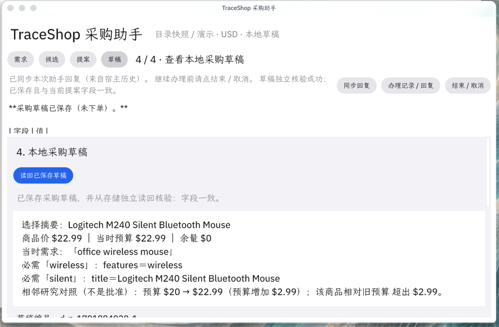

# TraceShop 采购助手

**无解时协商，批准后行动，执行后核验。**

TraceShop 是运行在 OctoSense 中的 OctoScript / Splash 应用。你给出需求、预算与硬条件，Agent 研究商品、解释取舍并创建采购提案；需要调整预算或保存采购草稿时，由宿主分别请求批准。保存后，Agent 再读取实际草稿，核对执行结果。

参赛队伍：**TraceShop** · 成员：**TraceShop-Felix** · 赛道：**OctoSense 购物与物流** · Apache-2.0 · [English](README.en.md)

> **本次演示：0.5.4 · 官方 RC6 · 真实 MiniMax-M3。** 在同一任务中完成预算协商、重新研究、保存批准与独立读回。运行范围及已知限制见[验证说明](docs/VALIDATION.md)；正式封存包以 GitHub Release 为准，上架状态以 App Hub 为准。

## 两分钟看懂

[观看原生演示（MP4，112.74秒）](evidence/rc6-budget-202120/demo.mp4) · [中文字幕](evidence/rc6-budget-202120/demo.zh-CN.srt) · [素材与运行证据](evidence/rc6-budget-202120/README.md)

本轮演示只讲一个完整任务：

1. 用户需要办公无线鼠标，预算 **20 美元**，必须有无线和静音证据。
2. Agent 研究后发现：便宜的商品缺少静音证据，有证据的商品又超预算。
3. Agent 提出具体取舍：把预算增加 **2.99 美元**，考虑 M240；预算修改先请求宿主批准。
4. 获得批准后，在**同一任务**中按新预算重新研究，再创建提案。
5. 保存采购草稿需要**另一次批准**；保存后独立读取草稿并核对字段。

上述步骤均来自同一次真实运行。演示剪去等待，保留原生批准与实际结果；官网快照和本地草稿范围在画面中标明。

[演示说明](docs/DEMO.zh-CN.md) · [运行与复现](docs/REPRODUCING.md) · [实际验证范围](docs/VALIDATION.md) · [提交说明](SUBMISSION.md)

## 为什么选购物

购物把 Agent 的三个难题放在一个容易理解的任务里：**在约束下找候选、在冲突中作取舍、让行动产生可核验的结果**。它的价值不止是生成推荐文字：当预算不足或条件变化时，Agent 应明确指出冲突，请求必要的决定，再继续办理。

TraceShop 让模型负责研究与行动选择，让应用负责条件检查、版本绑定和实际存储，让宿主负责预算修改与草稿保存的批准。建议、批准和执行结果各有明确来源。这些边界可供采购审批、差旅选择等场景参考；迁移仍需适配各自的数据与业务规则。

## Agent 能做什么

应用有八个工具，界面按钮与工具共用业务逻辑：

| 工具 | 作用 |
| --- | --- |
| `shopping.status.read` | 读取任务、条件与当前状态 |
| `shopping.catalog.select` | 切换合成目录或官网快照目录 |
| `shopping.catalog.research` | 检查预算、硬条件，给出候选、证据与只读替代项 |
| `shopping.proposal.create` | 根据本次研究创建待确认提案 |
| `shopping.proposal.read` | 读取提案与选择依据 |
| `shopping.task.budget.set` | 经宿主批准修改预算，并要求重新研究 |
| `shopping.draft.save` | 经独立宿主批准保存本地草稿 |
| `shopping.draft.read` | 读取实际草稿并核对当前提案 |

预算批准不会自动授权保存。条件或报价变化后，旧提案不能沿用旧版本直接保存。缺少目录证据只表示“尚未证实”，不等于商品没有该功能。

## 数据与实际能力

- 默认目录包含 14 条虚构演示商品；演示使用另一个目录中的 **3 条人工整理的 Logitech 美国官网快照**，以 USD 计价。价格不是实时信息，也不包含税费、运费或配送验证。
- 原生应用当前使用规则检索和显式字段证据。没有把 Project A 的模型、Jev 或生成式推荐实验接入本版应用。
- 动作结果是宿主私有存储中的**本地采购草稿**，没有真实下单、付款或物流操作。
- 模型由宿主配置，应用不保存模型 API 密钥。已有真实模型运行使用 MiniMax-M3；本版已在官方 Linux RC6 完成所述演示，其他系统未作兼容性承诺。
- 已知宿主回复回调可能超时；应用提供显式历史同步与结束操作。读取到回复不代表宿主已经报告回合结束。

## 运行与源码

应用入口是 [`bundle/`](bundle/)，不是历史 Web 原型：

- [`main.splash`](bundle/main.splash)：原生界面、研究、提案、任务状态与草稿保存。
- [`tools.json`](bundle/tools.json)：八个工具及其宿主确认策略。
- [`AGENT.md`](bundle/AGENT.md)：应用 Agent 的办理约定。
- [`manifest.json`](bundle/manifest.json)：应用身份、能力与模型要求。

使用支持 `script-tools-v1` / `app_tools.dispatch@1` 的 [OctoSense 官方宿主](https://github.com/OctoSense-org/OctoSense/releases)。截至 2026-10-13，最新桌面发布为 **desktop-v0.1.0-rc.6**。开发、打包和安装按[官方 App Flow](https://github.com/OctoSense-org/OctoSense-App-Flow/blob/main/README.zh-CN.md)及本仓库[运行说明](docs/REPRODUCING.md)操作；真实 Agent 路径需在宿主配置支持工具调用的模型。

本仓库保留可编辑源码。正式封存包、清单与发布回执以成功的 [GitHub Release](https://github.com/prettygirlisnotme/TraceShop/releases) 为准；工作流成功也不等于 App Hub 已审核接纳。发布与评审进度见[提交说明](SUBMISSION.md)。

## 对 OctoSense 的贡献

一个可阅读、可复用的原生购物应用示例：通过官方脚本工具协议提供任务状态与动作，通过宿主批准处理预算修改和草稿保存，再以独立读回核验结果。我们公开对应源码、演示和验证范围，方便其他应用开发者参考。

现有 [App Hub #71](https://github.com/OctoSense-org/OctoSense-App-Hub/issues/71) 的 **86/100 与初赛入围评语针对历史 v0.4.0**。当前不宣称已有上游核心代码贡献被合并，也不把应用示例当成平台本身的能力升级。

[开发说明](docs/DEVELOPMENT.md) · [接手入口](docs/HANDOFF.md) · [隐私说明](PRIVACY.md) · [许可证](LICENSE)
