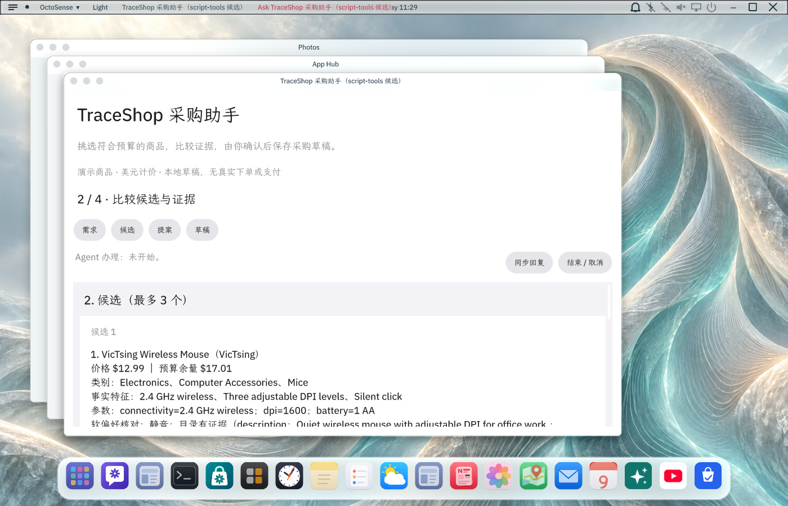
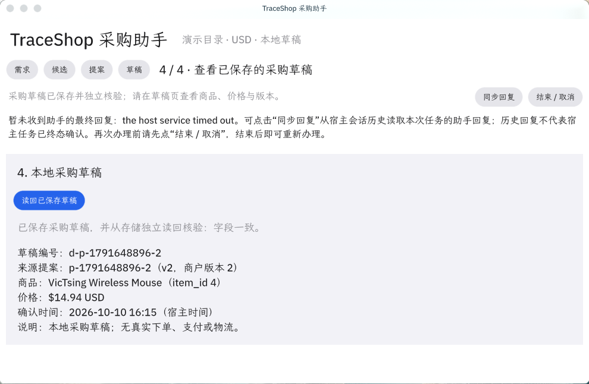

# TraceShop 采购助手

让 Agent 根据商品事实研究候选，在保存前请求宿主确认，再独立读回本地采购草稿。

主程序是 **OctoScript / Splash** 应用：[`bundle/main.splash`](bundle/main.splash)。六个应用工具与界面共用同一套研究、提案、保存业务核心：Agent 可以读取状态、研究候选、创建/读取提案、发起宿主批准保存、独立读回草稿。候选与提案展示目录原始字段，把“目录有证据”与“目录未证实”分开，未证实不反推为不支持。

内嵌 **14 条合成演示商品（USD）**。保存的是宿主私有目录中的本地采购草稿，**没有真实订单、支付或物流**。

## 演示录像（人工 UI 自动化）

[新版原生界面录像 98.96 秒](evidence/native-ui-196958.mp4) · [中文字幕](evidence/native-ui-196958.zh-CN.srt) · [录制摘要](evidence/native-ui-196958.json)。

282 帧连续采集、按实际帧间时长编码为 VFR H.264、无剪切、无音轨。该录像记录人工 UI 按钮流程，由自动化操作，零模型调用。真实 M3 自主工具证据见下方运行196923，两者分别标注。

| 商品证据 | 草稿读回 |
| --- | --- |
|  |  |

本轮人工 UI 流程完成：选择有静音目录证据的商品、保存并独立读回、模拟报价上涨 15% 后拒绝旧提案且不覆盖原草稿。官方 `hub stamp/check --allow-unsigned` 通过（[输出](evidence/bundle-check-196958.txt)），仍为 unsigned，**不代表 GitHub 证明或 App Hub 准入**。

## 核心闭环

1. 需求 + USD 预算 + 硬关键词 → 确定性规则检索，最多 3 个候选及原始字段证据。
2. 选中候选 → 生成绑定研究版本、商户版本与请求快照的**待确认提案**（不写草稿）。
3. Agent 调用 `shopping.draft.save` 发起宿主批准：`risk=destructive`、`confirm=host`、不可自动批准；调用工具不等于用户批准。
4. 批准后才写入草稿，并独立 `shopping.draft.read` 读回核对字段。
5. 报价、需求或版本变化使旧提案失效；重启后从私有存储恢复已保存草稿。

## 真实模型证据（M3 自主办理，运行 196923）

- CPU 作业 **196923 COMPLETED 0:0，7 分 32 秒**：在未修改的官方 OctoSense Linux 0.1.0-rc.1 包、真实商店 Get→Install→Open 的隔离副本上，真实 CN MiniMax-M3 自主完成 `status.read → catalog.research → proposal.create → draft.save → draft.read → final`。**6 次模型请求、5 个工具调用**，`readback_ok=true`，独立读回的 **8 个草稿字段与提案一致**。批准前无草稿，批准后才有。选中 item4 **VicTsing Wireless Mouse，12.99 USD**，预算余量 17.01。
- 静音依据来自目录原始字段 `description="Quiet..."` 与 `features="Silent click"`（`documented`）；另外两个候选为 `not_documented`，只表示**本演示目录未证实**，不等于商品不支持静音。人工只批准宿主权限和保存，未做人工研究、选候选或建提案。
- 证据入口：[脱敏运行摘要](evidence/agent-run-196923.json) · [宿主保存批准](evidence/agent-host-approval-196923.png) · [写入后草稿](evidence/agent-draft-196923.png)。

### 验证范围与已知限制

- 宿主存在 **60 秒回调超时**。本轮通过手动同步本次任务历史取回真实 final 文字，与上游 final **逐字相同**；但历史不提供 turn 终态，**仍需用户明确结束**。
- 首次工具授权后立即重试的问题**未定位**；观察到延后重试成功不能算根因修复。
- 原始 final 出现一处价格比较错误（称“其余两条候选价低”，而 item1=11.99 更低、item2=14.99 更高、选中 12.99）。**原文不可修改**；业务字段读回通过只证明 8 个字段一致，**不证明每句自然语言正确**。
- 运行后收紧了价格说明指令与 `draft.read` 字段指引，**但未重新运行模型**，不能声称该错误已消除。
- 声明 6 个工具，本序列实际调用 5 个，`proposal.read` 未单独调用；未证明全部 UI、手机端或所有 Agent 路径可操作。

## 使用

1. 输入需求、USD 预算和硬关键词，或使用办公/游戏/便携预设。
2. 可手动研究/选择/确认，也可点“交给 Agent 办理采购草稿”委托宿主 Agent。
3. Agent 保存会触发宿主确认；批准后才写入本地草稿。
4. 查看草稿读回；报价变化后须重新研究、生成提案。

需要支持 `script-tools-v1` / `app_tools.dispatch@1` 的 OctoSense 宿主。应用不申请 `net`，不持有模型 API 密钥；模型服务由宿主配置。见[复现说明](docs/REPRODUCING.md)。

## 发布与合规状态

- 公开仓库：[prettygirlisnotme/TraceShop](https://github.com/prettygirlisnotme/TraceShop)；已发布版本见 [Releases 页面](https://github.com/prettygirlisnotme/TraceShop/releases)。
- App Hub 提交：[OctoSense-App-Hub #71](https://github.com/OctoSense-org/OctoSense-App-Hub/issues/71)。上架、审核与奖项状态以各页面当前显示为准。
- 仓库保留可编辑的开发 bundle；正式封存包、GitHub证明与发布回执以 Releases 资产为准。0.5.0 的开发检查记录见上方，App Hub 审核仍是独立流程。

## 文档

| 文件 | 作用 |
| --- | --- |
| [main.splash](bundle/main.splash) | 界面、研究/提案/保存共享业务核心、任务恢复 |
| [tools.json](bundle/tools.json) | 6 个应用工具、风险等级与宿主确认要求 |
| [AGENT.md](bundle/AGENT.md) | 办理顺序、证据要求、确认与失败语义 |
| [VALIDATION.md](docs/VALIDATION.md) | 精确验证范围、宿主与已知限制 |
| [DEMO.zh-CN.md](docs/DEMO.zh-CN.md) | 三分钟答辩稿与高价值问答 |
| [HANDOFF.md](docs/HANDOFF.md) | 开发者接手与发布边界 |

[English overview](README.en.md) · [隐私说明](PRIVACY.md) · [Apache-2.0](LICENSE)。

发布者：TraceShop-Felix。支持：[GitHub Issues](https://github.com/prettygirlisnotme/TraceShop/issues)。
