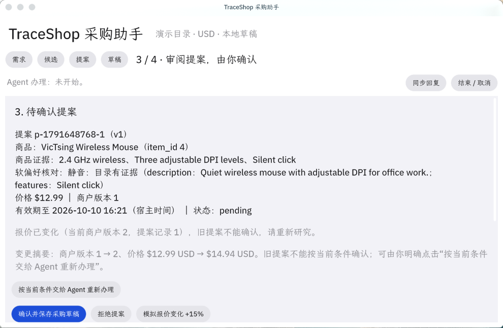
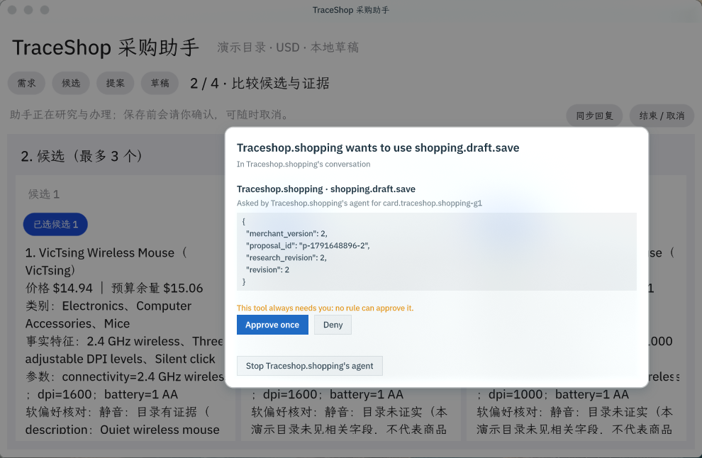

# TraceShop 采购助手

> 让 Agent 在条件变化后自主重新研究、创建提案；宿主批准后写入本地草稿，再由 Agent 独立读回核对。

TraceShop 是一个 **OctoScript / Splash** 应用（[`bundle/main.splash`](bundle/main.splash)）。它把“按商品事实做采购决策”拆成可确认、可核对的步骤：Agent 读取状态、研究候选、创建提案，然后**请求宿主批准**保存；批准后才写入宿主私有存储中的本地草稿，并由 Agent 独立读回验证字段。界面按钮与六个应用工具共用同一套研究、提案、保存业务核心，不维护两套逻辑。

目录是 **14 条合成 USD 商品**；草稿写入宿主私有存储，**没有真实下单、支付或物流**。

## 评委快速了解

- **问题**：让采购建议成为可核验的行动，而不是一句自然语言结论。候选与提案都展示目录原始字段，明确区分“目录有证据”与“目录未证实”。
- **Agent 自主范围**：真实 MiniMax-M3 自主完成状态读取、候选研究、提案创建、发起保存、独立读回并给出最终总结。**保存动作不可自动批准**——必须宿主 `Approve once`。
- **最新演示**：报价从 12.99 变到 14.94 USD 后，人工建立的旧提案确认被拒绝且**不产生草稿**；用户明确交给 Agent 重办，模型重新研究、重新创建提案、经新宿主批准后写入并读回。详见[运行 197305 证据](evidence/agent-run-197305.json)。
- **边界**：目前只有单用例真实验证；回调超时与授权重试根因未修；六工具未逐一实测；合成目录无真实交易，未接入原生 Project A。

## 核心闭环

1. 需求 + USD 预算 + 硬关键词 → 确定性规则检索，最多 3 个候选及原始字段证据。
2. 选中候选 → 生成绑定研究版本、商户版本与请求快照的**待确认提案**（不写草稿）。
3. Agent 调用 `shopping.draft.save` 发起宿主批准：`risk=destructive`、`confirm=host`、不可自动批准；调用工具不等于用户批准。
4. 批准后才写入草稿，并独立 `shopping.draft.read` 读回核对字段。
5. 报价、需求或版本变化使旧提案失效；重启后从私有存储恢复已保存草稿。

## 最新真实验证（MiniMax-M3，运行 197305）

在**未修改**的官方 OctoSense Linux 0.1.0-rc.1（隔离私有 Store 安装）上，真实 CN MiniMax-M3 自主办理：

- 场景从人工建立的一份**待确认旧提案**（12.99 USD）起始；报价变化到 **14.94 USD** 后，旧确认被**拒绝且未写入草稿**（`stale_confirmation_rejected_no_draft=true`）。
- 用户明确把任务交给 Agent 重办，模型自主执行 `status.read → catalog.research → proposal.create`，再经宿主 **Approve once** 执行 `draft.save → draft.read → final`。
- 6 次模型请求、5 个工具调用；`readback_ok=true`，独立读回的 **8 个草稿字段与提案一致**。批准前无草稿，批准后才写入。
- 选中 item4 **VicTsing Wireless Mouse，14.94 USD**，预算余量 **15.06**；`draft_id=d-p-1791648896-2`，`proposal_id=p-1791648896-2`，`revision=2`，`research_revision=2`，`merchant_version=2`。
- 静音依据来自目录原始字段 `description="Quiet..."` 与 `features="Silent click"`（`documented`）；另外两个候选为 `not_documented`，只表示**本演示目录未证实**，不等于商品不支持静音。
- 本轮 final 的价格说明与目录原始价格一致（`prices_correct_in_this_run=true`）；同步的本次任务历史文字与上游 provider final **逐字相同**，并已**显式结束**任务。
- 源码与紧凑界面均在本次 197305 运行中验证。

## 演示素材

[94秒原生实录节选](evidence/native-agent-excerpt-197305.mp4) · [中文字幕](evidence/native-agent-excerpt-197305.zh-CN.srt) · [采集与剪辑来源](evidence/native-agent-media-197305.json)。

素材均来自同一次197305运行。完整原片368.169秒、368帧、零采集错误，保存在私有集群报告中；本仓库提供94秒节选，剪去等待并裁出完整应用窗口，保留原生权限弹窗，不加速、不生成画面、无音轨。

录制时，测试控制器自动化操作界面来建立旧提案、点击首次授权及保存批准；MiniMax自主完成新研究、选择、新提案与保存/读回工具调用。应用和执行模型不能自动批准保存。

| 报价变化后 | 宿主 Approve once |
| --- | --- |
|  |  |

[独立读回](bundle/screenshots/03-readback.png) · [最终完成](bundle/screenshots/04-complete.png)。四张均为同次实图的应用窗口裁切，像素与原始裁切一致。

历史78.24秒人工UI录像与196923早期模型记录保留，不作新版主证据。

## 边界与已知限制

- **回复显示**：紧凑界面只显示长回复开头；完整本次回复见运行证据JSON，商品、价格和版本以草稿结构化字段为准。
- **单用例**：只在“办公用无线鼠标、安静、USD 预算”这一条真实模型用例上验证，不代表全部路径或 100% 自主。
- **宿主限制仍在**：60 秒回调超时仍存在，真实 final 通过显式同步本次任务历史取回；历史不提供 turn 终态，**仍需用户明确结束**。首次工具授权后立即重试的时序根因**未定位**。
- **未全部实测**：预算 13 场景与全部六工具未逐一实测；本序列调用 5 个工具，`proposal.read` 未单独调用。
- **无真实交易/上游**：目录为 14 条合成 USD 商品，未接入真实商品/检索服务或原生 Project A，无真实下单、支付或物流。
- **开发包检查通过**：最终10个包文件与官方作业197371完全一致，stamp/check --allow-unsigned为PASSED（[输出](evidence/bundle-check-replan.txt) · [摘要](evidence/bundle-check-replan.json)）。仍为unsigned，不代表生产签名、Release或App Hub准入。

## 使用

1. 输入需求、USD 预算和硬关键词，或使用办公/游戏/便携预设。
2. 可手动研究/选择/确认，也可点“交给 Agent 办理采购草稿”委托宿主 Agent。
3. Agent 保存会触发宿主确认；批准后才写入本地草稿。
4. 查看草稿读回；报价变化后，在提案页查看差异，明确点击“按当前条件交给 Agent 重新办理”。

需要支持 `script-tools-v1` / `app_tools.dispatch@1` 的 OctoSense 宿主。应用不申请 `net`，不持有模型 API 密钥；模型服务由宿主配置。见[复现说明](docs/REPRODUCING.md)。

## 发布与合规状态

- 公开仓库：[prettygirlisnotme/TraceShop](https://github.com/prettygirlisnotme/TraceShop)；本工作树**尚未 push**。
- App Hub 提交：[OctoSense-App-Hub #71](https://github.com/OctoSense-org/OctoSense-App-Hub/issues/71)。上架、审核与奖项状态以各页面当前显示为准。
- 仓库保留可编辑的开发 bundle；正式封存包、GitHub 证明与发布回执以 Releases 资产为准，App Hub 审核仍是独立流程。

## 文档

| 文件 | 作用 |
| --- | --- |
| [main.splash](bundle/main.splash) | 界面、研究/提案/保存共享业务核心、任务恢复 |
| [tools.json](bundle/tools.json) | 6 个应用工具、风险等级与宿主确认要求 |
| [AGENT.md](bundle/AGENT.md) | 办理顺序、证据要求、确认与失败语义 |
| [VALIDATION.md](docs/VALIDATION.md) | 精确验证范围、宿主与已知限制 |
| [DEMO.zh-CN.md](docs/DEMO.zh-CN.md) | 三分钟答辩稿与高价值问答 |
| [HANDOFF.md](docs/HANDOFF.md) | 开发者接手与发布边界 |

[English overview](README.en.md) · [隐私说明](PRIVACY.md) · [Apache-2.0](LICENSE)。

发布者：TraceShop-Felix。支持：[GitHub Issues](https://github.com/prettygirlisnotme/TraceShop/issues)。
