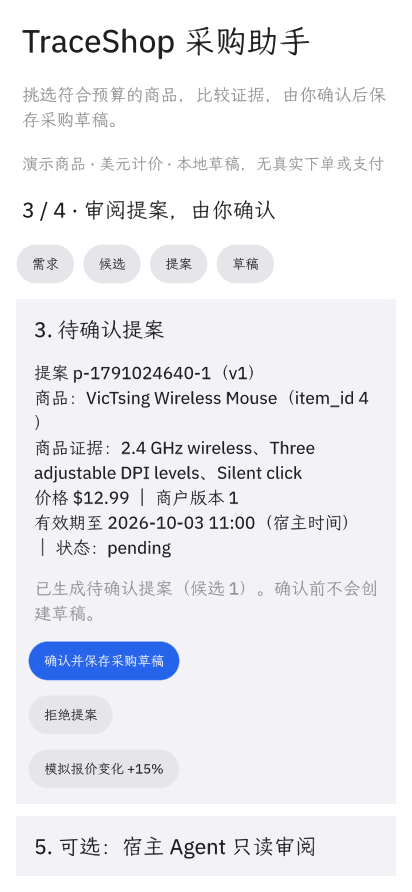

# TraceShop 采购助手

把商品需求变成可确认的采购提案：比较候选与证据，确认后保存采购草稿，再从存储读回核验。

主程序使用 **OctoScript / Splash**，位于 [`bundle/main.splash`](bundle/main.splash)。商品检索、提案状态、用户确认和草稿存储都在脚本应用内完成。

当前源码版本为 **0.4.1（待发布）**：与 v0.4.0 应用逻辑相同，仅补充中文文档、真实状态截图和官方 `tools/octo publish-github` 发布配置。v0.4.0 已在官方 `card-host` 的 Linux 环境实际运行，核心流程已验证。**已提交 [App Hub #71](https://github.com/OctoSense-org/OctoSense-App-Hub/issues/71)，2026-10-09 初赛评审结果为入围、86/100，评审版本 v0.4.0（`4cf35ca8`）**；App Hub 上架与奖项待后续流程。


## 评审结果（初赛）

2026-10-09，官方维护者 ZhangHanDong 在 [App Hub #71 评论](https://github.com/OctoSense-org/OctoSense-App-Hub/issues/71#issuecomment-6077956506) 给出结果：**入围，86/100，评审版本 v0.4.0（`4cf35ca8`）**。App Hub 上架、人工审核与奖项待后续流程。评审建议已在本轮 0.4.1 的文档、截图与发布配置中回应。

## 提案确认与草稿读回

两张关键状态图来自 v0.4.0 官方 `card-host` 真实运行素材，0.4.1 直接复用：

| 提案确认 | 草稿读回 |
| --- | --- |
|  |  |

## 文档导航

| 文档 | 内容 |
| --- | --- |
| [README.md](README.md) | 本页：概览、运行方式与证据入口 |
| [SUBMISSION.md](SUBMISSION.md) | 初赛提交材料、下一轮安排与发布配置 |
| [docs/VALIDATION.md](docs/VALIDATION.md) | 实际运行范围与固定宿主版本 |
| [docs/APP_HUB_REVIEW.md](docs/APP_HUB_REVIEW.md) | 作者对 Hub 扫描的答复（中英对照） |
| [PRIVACY.md](PRIVACY.md) | 隐私说明 |
| [docs/DEMO.zh-CN.md](docs/DEMO.zh-CN.md) | 中文演示提纲、设计取舍与答辩问题 |
| [docs/DEVELOPMENT.md](docs/DEVELOPMENT.md) · [docs/REPRODUCING.md](docs/REPRODUCING.md) | 开发与复现说明 |

## 模型验证口径

以下口径在 [README](README.md)、[SUBMISSION](SUBMISSION.md) 和 [作者答复](docs/APP_HUB_REVIEW.md) 三处保持一致。

- 模型实测针对 v0.4.0 的同一业务脚本；0.4.1 只改文档、截图与发布配置，没有新的模型验证。
- 官方 Linux `card-host`（固定版本）实测了人工状态流转、人工确认与独立读回；宿主不提供 `octos` 审阅服务，应用如实显示不可用。
- 未修改的 standalone Rinx（固定 `5a9e2af`）使用其打包 octos 与 CN MiniMax-M3，在同一个 v0.4.0 bundle 上完成一条真实 JSON 审阅：模型建议 → 采纳生成 v2 待确认提案 → 明确人工确认 → 写入文件并独立读回一致。
- 未验证注入式 OctoSense Shell System Agent，也未验证手机/移动端。
- 该证据在 main 分支 `f07434ff` 收录，对应 v0.4.0（`4cf35ca8`）的 bundle BLAKE3；0.4.1 的 bundle 摘要以发布工作流产出为准，目前尚未发布。

## 使用

1. 填写需求、美元预算和必须包含的商品词，也可选择办公、游戏或便携预设。
2. 研究商品，比较最多三个候选的价格、特征和约束证据。
3. 选择候选，得到待确认提案；可请求宿主 Agent 审阅。
4. 明确确认后保存采购草稿，查看独立读回的结果。

模拟报价变化后，旧提案不能确认。需求或约束改变后须重新研究；拒绝提案不会创建新草稿。已保存的草稿可以在应用重启后恢复。

目录包含 **14 条合成演示商品，价格单位为 USD**。保存的是本地采购草稿，应用没有真实支付、下单或物流服务。

## 运行

先按 [官方开发流程](https://github.com/OctoSense-org/OctoScript-App-Design-Flow/blob/main/README.zh-CN.md) 准备 `hub`、`card-host` 和 `tools/octo`。在该流程工作区运行：

```bash
tools/octo run /path/to/TraceShop/bundle --port 8141 --hidden --detach
```

`--hidden` 用于开发时后台操作；需要可见窗口时去掉它。应用数据由宿主放在自身分配的私有目录中。

官方 `card-host` 当前不提供 `octos` 审阅服务，应用会显示真实的服务不可用提示；手动选择、确认和存储仍可使用。支持这些服务的宿主可以返回模型建议；v0.4.0 已完成一条真实建议采纳、人工确认与存储读回流程，[实测证据](evidence/native-agent-workflow.json)。完整、且与另外两份提交文档一致的口径见[模型验证口径](#模型验证口径)。

## 演示与验证

- [原生购物操作录屏](evidence/native-shopping.webm)
- [重启恢复录屏](evidence/native-restart.webm)
- [真实 Agent 回复与采纳截图](evidence/native-agent-review.png) · [采纳状态](evidence/native-agent-adoption.png) · [保存结果](evidence/native-agent-draft.png)
- [验证范围与固定宿主版本](docs/VALIDATION.md)
- [官方包检查输出](evidence/native-hub-check.txt)
- [初赛材料入口](SUBMISSION.md)

录屏由官方宿主的连续原生窗口帧采样后以 4fps 编码，播放速度与现场操作时间不同。

## 代码入口

| 入口 | 职责 |
| --- | --- |
| `research` | 预算与商品词过滤、候选事实与证据 |
| `pick` | 生成待确认提案 |
| `confirm_draft` | 核对需求、报价和有效期，写入并独立读回 |
| `request_review` / `adopt_suggestion` | 请求宿主审阅，核对建议来源，保持人工确认 |
| `boot` | 恢复已保存的草稿 |

应用包只申请存储和三个 `octos` 宿主服务，不持有模型密钥。主动请求审阅时，需求和候选资料可能经宿主发送到其配置的模型服务。

既有网页原型和辅助审阅器的历史发布见 [v0.3.0](https://github.com/prettygirlisnotme/TraceShop/releases/tag/v0.3.0)。当前应用入口是 `bundle/`。

发布者：TraceShop-Felix。支持：[GitHub Issues](https://github.com/prettygirlisnotme/TraceShop/issues)；[隐私说明](PRIVACY.md)。

许可证：[Apache-2.0](LICENSE)。
