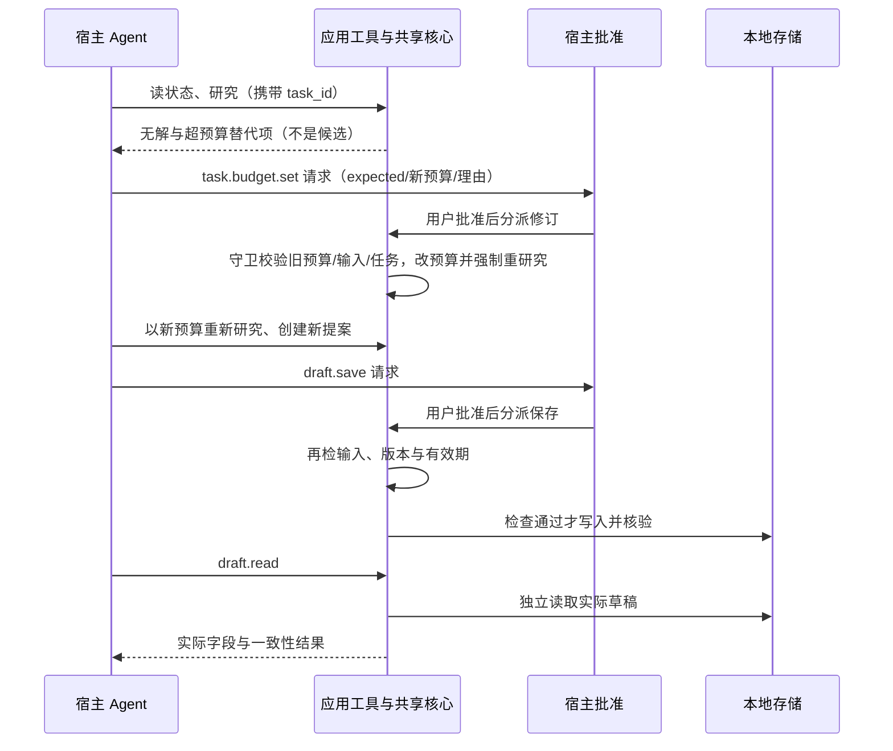

# 开发接手

更新：2026-10-12。先读[产品首页](../README.md)、[验证范围](VALIDATION.md)和[复现说明](REPRODUCING.md)。当前是私有 **0.5.4 候选**（未发布）：在 0.5.3 办理记录/完整回复界面上，合入已实测的预算修订第八工具。**本轮只做业务整合与文档，未对 0.5.4 新十文件整包运行官方发布检查，也未在本机运行、测试或调用比赛模型。**

## 代码与执行流程

- [main.splash](../bundle/main.splash)：`research_core` 执行预算/硬关键词筛选并保留原始字段证据，`create_proposal_at` 绑定需求与版本，`confirm_draft_core` 在写入时再次校验并读回；`revise_task_budget`（预算工具处理器）复用任务守卫，仅在宿主批准后更新绑定预算、保留 `initial_budget_usd` 并推进 `start_research_revision` 强制重研究。
- [tools.json](../bundle/tools.json)：**八个**宿主应用工具。`app_tool` 分派到共享业务核心；界面按钮和工具不维护两套采购逻辑。
- [AGENT.md](../bundle/AGENT.md)：模型办理顺序、证据引用、预算/保存批准、任务绑定与失败语义。商品字段是数据，不是开发指令。
- `agent_task_sync_reply` 读取本次任务历史；`agent_task_cancel` 明确结束。历史文字不提供 turn 终态，不能代替宿主完成信号。
- `agent_task_binding` 只由 `agent_task_launch` 捕获（`task_id` + 需求/预算/硬关键词/目录来源/商户版本/起始研究版本），写工具须携带匹配 `task_id`；它是应用本地快照，**不是宿主身份认证**。
- 界面：`selection_summary_text`（选择摘要前置）、`refresh_proposal`/`proposal_state_text`（独立状态标题）、“办理记录 / 完整回复”切换区（`switch_reply_view`、`activity_records_section`/`activity_reply_section`，各 360px、默认记录）、“预算取舍 $20”预填按钮；详细证据仍在原页面滚动区。
- 办理记录学习链：`app_tool` 分派 → `complete_shop_tool` 封装（先 `app_tools.complete` 原样返回，再记录）→ `activity_summary`/`trim_activity`（最多 12 条）→ `activity_records_text` → `switch_reply_view`。**边界**：它只反映本次实际工具返回，仅内存、非宿主认证、非模型推理、非完整审计，不能当作批准或任务终态；`agent_task_launch` 先清空记录，手动研究与助手文字不计入，原文一字不改。

“最多一次请求”是AGENT策略，当前处理器不以次数硬拒绝第二次有效修订；不得把提示当强制限次保证。

预算工具（`shopping.task.budget.set`）与保存工具（`shopping.draft.save`）都为 `risk=destructive`、`confirm=host`、`auto_approvable=false`。调用只是在请求批准；执行时的版本、输入、预期旧预算和时效校验仍须保留。

## 理解预算批准与保存批准两条分支

宿主拒绝时不分派预算修订与保存；状态校验失败时不写入。人工界面也复用研究和保存核心，但界面人工确认与 Agent 路径的宿主批准是两种入口。学习时先沿 `app_tool → research_core / decision.next_action → revise_task_budget → research_core → create_proposal_at → confirm_draft_core → draft_read_result` 阅读，再看 `app_tool` 如何分派到这些函数。

## 运行证据怎么对应源码（版本分开）

- **当前候选 0.5.4**：main `43b89dde…`、tools `4d10e50b…`、AGENT `d079839b…`；集群上游存放位置 `native/traceshop-budget-revision/bundle`。业务源码与上游预算修订候选完全一致，本候选只是合并 0.5.3 界面与文档、更新 manifest/listing 版本字段（manifest `max_iterations` 由 6 提到 8 以匹配已实测预算链路）。**尚未对新十文件整包运行官方发布检查，不代表已安装实测。**
- **199314 RC5 真实模型（0.5.4 业务源码）**：官方未修改 Linux RC5（`unmodified_official=true`）真实 Store 安装，真实 CN MiniMax-M3，CPU4/12GiB、0 GPU、6:47，8 次请求、7 次工具调用（6 种），17 项直接相关判据全过。流程：预算 20 无候选 → M3 直接请求 `shopping.task.budget.set`（旧 20 → 新 22.99）→ 主控按当次原生弹层 `Approve once` → 工具返回 `changed=true`/`fresh_research_required=true` → 以 22.99 重研究并选 M240（`item102`）建提案 → `draft.save` 另经一次原生批准 → 即时读回 + `draft.read`（`read_ok=true`/`matches_current_proposal=true`/`verification_scope=proposal_fields`）。未调用 `catalog.select`/`proposal.read`。证据见上游 `live-check/run-199314/`（`live-result.json`、`approval-events.json`、`purchase_draft.json`、`relay.jsonl`、`usage-summary.json`、`sacct.txt` 与 `source-at-run/`）。
- **199373 RC6 固定协议（0.5.4 业务源码）**：官方未修改 Linux RC6 真实 Store 安装、CPU4/12GiB、5:38、0 GPU，**零真实模型**、无草稿保存，17 UI + 23 协议通过（预算 20→23、旧预算重试被拒、强制重研究、待确认提案）。同源 199360 因运行器 280 秒总时限 FAILED（CPU4/6:05），仅把演练时限改 480 秒后 199373 通过，未改业务；证据见上游 `check/run-rc6-199373/budget-result.json` 与 `reports/20261011-upstream-alignment/upstream-refresh/rc6-20261012.json`。
- **199222 确定性协议（旧源码 `main fa1a3e15…` / `tools c33cfc32…`）**：17 UI + 23 协议通过；旧预算重试、用只读替代直接建提案、未经重研究均被拒；只到提案，无保存。**源码与当前不同，不继承结论。**
- **199271 RC5 真实 M3 失败（旧源码）**：多一次聊天询问后发出 22.99 预算请求，内核记下 budget `approval_requested`（seq64），但未捕获可操作弹层，未改预算/提案/保存；主控结束测试产生的 `approval_cancelled`/`turn_interrupted`（seq70）**不是自行撤回或自动过期**，界面未显示原因未确定。证据见上游 `live-check/run-199271/`。
- **0.5.3 基线 main `17bb585a…`**：198504 RC5 固定协议零模型办理记录/完整回复（25 UI + 12 协议，4:56；上游测试副本 manifest 为 0.5.2 + 测试 publisher/签名），布局调整前 198494（main `05764fd4…`）覆盖滚动取景与逐字一致。
- **0.5.2 基线 main `7e0c08e1…`**：198377 RC5 首次使用流程通过 22 项断言、零模型、1:05，未跑 Agent 分支；同 main 的 198373 因旧提示文案 FAILED，失败与源码保留在根项目 `native/traceshop-onboarding/check/run-198373/`。
- **0.5.1 基线 main `18647a97…`**：198242 RC5 人工 UI 13 项通过（零模型、2:51）；198316 RC5 真实 M3（`status`/`research`/`proposal.create`/`draft.save`/`draft.read`、宿主批准保存 M240 $22.99、独立读回，`passed=true`、7:43）。**均不适用于 0.5.4 业务源码。**
- **198215 / 197799 历史旧包**：main `18647a97…`/`fc005b81…`、AGENT `f02c135f…`/`06a058…`、manifest `af045121…`、listing `9944a0d7…`，人工 UI 与较早真实 M3 记录；包字节验证不继承。
- **197305 历史包**：main `4c3a5daa…`，其 94 秒视频与四张截图仅作历史，不适用于当前包。

精确摘要见 [package-inputs.json](../package-inputs.json) / [expected-sha256.json](../expected-sha256.json)，CPU 位置与未测项见 [VALIDATION](VALIDATION.md)。

当前是 14 条合成 + 3 条官网快照（整理摘要、非实时、仅商品价）的规则决策，不包含真实下单、支付、物流或真实检索模型效果。

## RC5 真实 M3 与 RC6 固定协议的区别

- **199314（RC5，真实模型）**：真实 CN MiniMax-M3 自主决策，含预算工具的原生批准与保存另批、强制重研究、独立读回；是预算闭环的**真实模型**主证据。宿主 60 秒回调仍可能超时，本次真实 final 经一次显式历史同步恢复后主控显式结束。
- **199373（RC6，固定协议）**：固定 loopback 协议输入、**零真实模型**，验证 0.5.4 工具/界面在 RC6 官方宿主的兼容与拒绝分支（旧预算重试、强制重研究、待确认提案），**不能**当作真实模型或自主决策证据。
- 兼容性判断为源码/文档级（`script-tools-v1` / `app_tools.dispatch@1` / `confirm=host` 路径），与运行证据分开；正式发布前仍需锁定并检查最终十文件。

## 条件变化后的重办入口

`proposal_change_summary` 比较提案快照与当前报价/输入/时钟；`agent_replan` 检查真实失效且未保存、未拒绝、无任务运行，再由共同的 `agent_task_launch` 发起新任务。上下文只是旧/新事实，不是批准；Agent 必须取得新研究版本并建立新提案。保存时再次校验，不能重用旧批准。预算修订也遵守同一原则：批准只改预算并强制重研究，旧提案随后被版本守卫拒绝保存。

## 后续优先级

先保持核心闭环与可复现交付；新实录和答辩定稿继续暂缓。0.5.4 已把预算闭环整合为单一候选，界面保留“办理记录 / 完整回复”切换区与“预算取舍 $20”预填按钮。真实模型预算闭环已由 199314 覆盖、RC6 兼容由 199373 覆盖，**不补机械测试矩阵**。宿主 60 秒回调限制仍在，超时已有有界最小复现与私有反馈草稿，不自动重开无限排查。接入实时商品目录或在线检索服务时保持业务核心与宿主适配分离，并单独报告数据来源和检索效果。新实录/答辩定稿按用户安排继续暂缓；对外发布逐次批准。

本轮未在本机运行/测试/调用比赛模型；已实测业务源码与运行证据托管在上游私有目录 `native/traceshop-budget-revision/`，本候选只复制少量原始JSON/摘要到evidence/rc5-budget-199314和evidence/rc6-budget-199373；不复制完整日志/视频。正式发布前仍需锁定工作流检查最终十文件。
