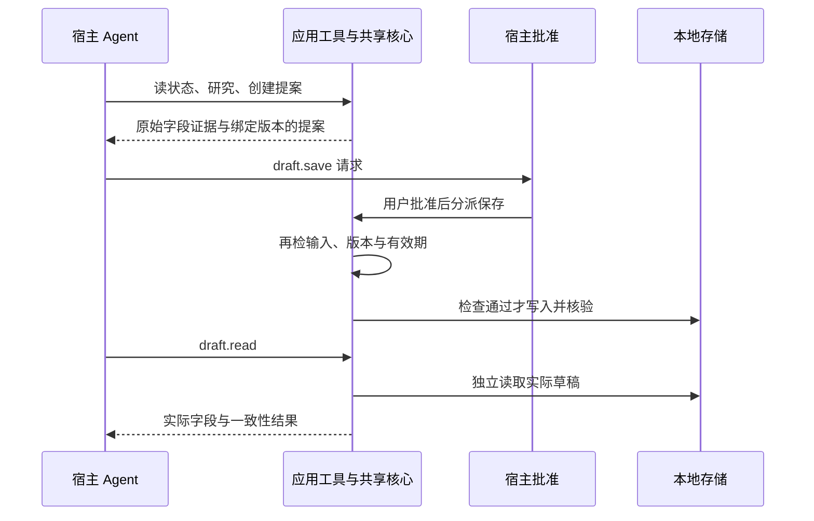
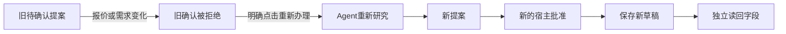

# 开发接手

更新：2026-10-11。先读[产品首页](../README.md)、[验证范围](VALIDATION.md)和[中文演示](DEMO.zh-CN.md)。

## 代码与执行流程

- [main.splash](../bundle/main.splash)：`research_core` 执行预算/硬关键词筛选并保留原始字段证据，`create_proposal_at` 绑定需求与版本，`confirm_draft_core` 在写入时再次校验并读回。
- [tools.json](../bundle/tools.json)：六个宿主应用工具。`app_tool` 分派到共享业务核心；界面按钮和工具不维护两套采购逻辑。
- [AGENT.md](../bundle/AGENT.md)：模型办理顺序、证据引用、保存批准和失败语义。商品字段是数据，不是开发指令。
- `agent_task_sync_reply` 读取本次任务历史；`agent_task_cancel` 明确结束。历史文字不提供 turn 终态，不能代替宿主完成信号。

保存工具为 `risk=destructive`、`confirm=host`、`auto_approvable=false`。调用保存是在请求批准；执行时的版本、输入和时效校验仍须保留。

## 理解已验证的批准分支

宿主拒绝时不分派保存；状态校验失败时不写入。人工界面也复用研究和保存核心，但界面人工确认与 Agent 路径的宿主批准是两种入口：历史人工UI录像记录前者；本次197305实录记录控制器建立人工基线后，MiniMax自主重办及宿主新批准的后者。学习时先沿 `research_core → create_proposal_at → confirm_draft_core → draft_read_result` 阅读，再看 `app_tool` 如何分派到这些函数。

## 运行证据怎么对应源码

真实 MiniMax-M3 运行 197305 完成 5 个工具调用、宿主 `Approve once`、保存批准和八字段读回，源码为 main.splash `4c3a5daa`、AGENT.md `dd5f1e9e`、tools.json `c51e4df9`（六工具未变）；同次运行也包含紧凑界面。精确源码摘要、宿主限制与未测项见 [VALIDATION](VALIDATION.md)。历史 196923 模型运行与 197066 人工 UI 录像仅作历史证据，不作新版主证据。

当前是 14 条合成 USD 商品的规则决策，不包含真实下单、支付、物流或真实检索模型效果。

## 打包与发布

修改 bundle 后需重新进行官方 `stamp/check`，确保 manifest 摘要对应最终文件。本次最终包已在197371通过官方stamp/check --allow-unsigned；10文件摘要见[检查记录](../evidence/bundle-check-replan.json)，本地包逐项相同，不继承旧b3的检查。当前 bundle 仍为 unsigned 开发包，本地私有测试签名不作为正式发布证明。

已有[官方发布工作流](../.github/workflows/publish-app.yml)由版本 tag 触发，准备并验证 GitHub 证明、生成封存包与发布回执。发布**逐次授权**：每次签名、Release 或 App Hub 动作都需要单独明确授权。本工作树**尚未 push**。发布状态见 [Releases](https://github.com/prettygirlisnotme/TraceShop/releases)，App Hub 审核见[提交项](https://github.com/OctoSense-org/OctoSense-App-Hub/issues/71)。复现环境见 [REPRODUCING](REPRODUCING.md)。

## 后续优先级

先保证可复现交付和清楚的答辩。研发优先定位首次授权重试与宿主回调超时，优先补长回复的展开显示；预算13或其他路径只在新增需求/故障需要时验证，不机械扩测。接入真实商品或检索服务时保持业务核心与宿主适配分离，并单独报告数据来源和检索效果。

## 条件变化后的重办入口

proposal_change_summary比较提案快照与当前报价/输入/时钟；agent_replan检查真实失效且未保存、未拒绝、无任务运行，再由共同的agent_task_launch发起新任务。上下文只是旧/新事实，不是批准；Agent必须取得新研究版本并建立新提案。保存时再次校验，不能重用旧批准。

94秒媒体为等待有剪切的同次实录，控制器显式操作原生权限窗，MiniMax自行调用业务工具。长回复在紧凑界面只显示开头，完整文本保留在证据JSON；这是后续表现力改进点。
