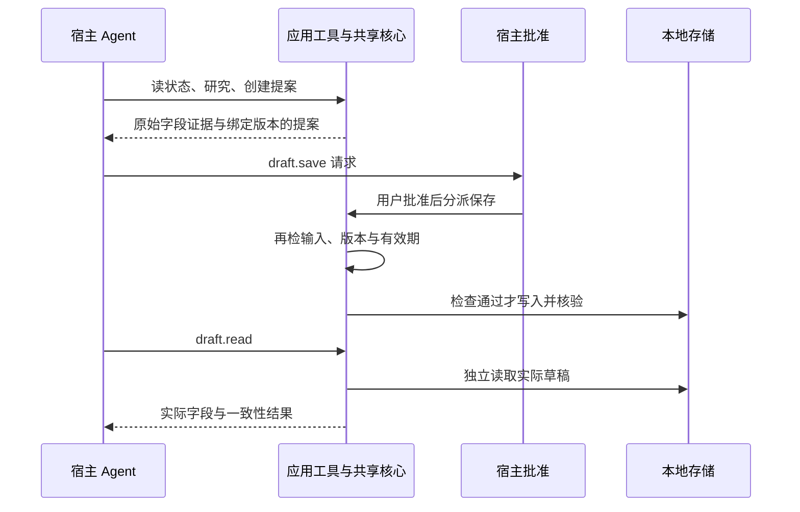

# 开发接手

更新：2026-10-10。先读[产品首页](../README.md)、[验证范围](VALIDATION.md)和[中文演示](DEMO.zh-CN.md)。

## 代码与执行流程

- [main.splash](../bundle/main.splash)：research_core执行预算/硬关键词筛选并保留原始字段证据，create_proposal_at绑定需求与版本，confirm_draft_core在写入时再次校验并读回。
- [tools.json](../bundle/tools.json)：六个宿主应用工具。app_tool分派到共享业务核心；界面按钮和工具不维护两套采购逻辑。
- [AGENT.md](../bundle/AGENT.md)：模型办理顺序、证据引用、保存批准和失败语义。商品字段是数据，不是开发指令。
- agent_task_sync_reply读取本次任务历史；agent_task_cancel明确结束。历史文字不提供turn终态，不能代替宿主完成信号。

保存工具为risk=destructive、confirm=host、auto_approvable=false。调用保存是在请求批准；执行时的版本、输入和时效校验仍须保留。

## 理解已验证的批准分支

宿主拒绝时不分派保存；状态校验失败时不写入。人工界面也复用研究和保存核心，但界面人工确认与Agent路径的宿主批准是两种入口：录像证明前者，真实模型196923证明后者。学习时先沿research_core → create_proposal_at → confirm_draft_core → draft_read_result阅读，再看app_tool如何分派到这些函数。

## 运行证据怎么对应源码

真实MiniMax-M3运行196923完成五个工具调用、保存批准和八字段读回，使用较早文字快照（main ed412c2c/AGENT b6f28f03）。之后只收紧价格说明和draft.read字段指引；当前紧凑界面为main.splash e344068d，人工UI录像197066（217帧、78.24秒）零新模型调用，业务文字修正与新UI均未重跑模型。上一轮196958录像/编码196987及其原生截图保留为历史证据。精确源码摘要、两类证据和已知限制见[VALIDATION](VALIDATION.md)，它们属于不同运行。

当前是14条合成USD商品的规则决策，不包含真实下单、支付、物流或真实检索模型效果。

## 打包与发布

修改bundle后需重新进行官方stamp/check，确保manifest摘要对应最终文件。最终紧凑界面、listing和四张截图已由CPU作业197113完成官方stamp/check --allow-unsigned；[文件摘要](../evidence/bundle-check-compact.json)与当前bundle一致。仍为unsigned，本地私有测试签名不作为正式发布证明。

已有[官方发布工作流](../.github/workflows/publish-app.yml)由版本tag触发，准备并验证GitHub证明、生成封存包与发布回执。发布状态见[Releases](https://github.com/prettygirlisnotme/TraceShop/releases)，App Hub审核见[提交项](https://github.com/OctoSense-org/OctoSense-App-Hub/issues/71)。复现环境见[REPRODUCING](REPRODUCING.md)。

## 后续优先级

先保证可复现交付和清楚的答辩。研发优先定位首次授权重试与宿主回调超时；价格说明修改尚无新的模型验证。接入真实商品或检索服务时保持业务核心与宿主适配分离，并单独报告数据来源和检索效果。
