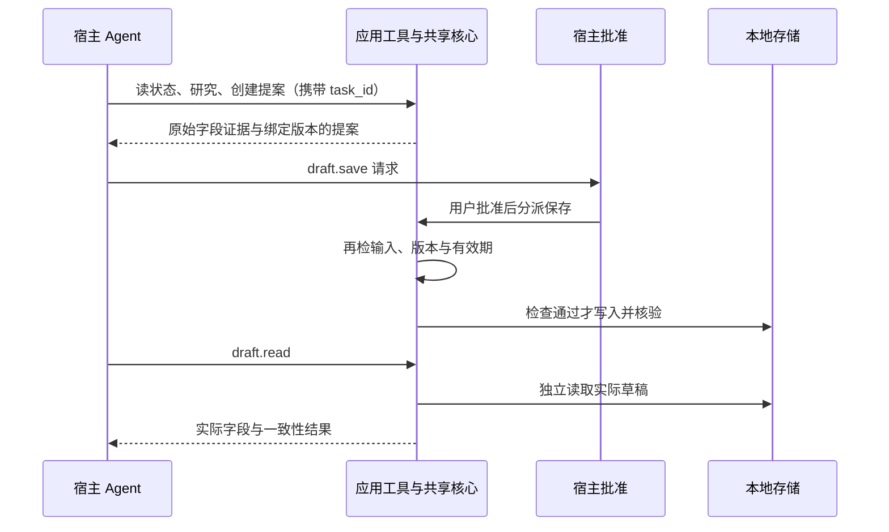

# 开发接手

更新：2026-10-11。先读[产品首页](../README.md)、[验证范围](VALIDATION.md)和[复现说明](REPRODUCING.md)。

## 代码与执行流程

- [main.splash](../bundle/main.splash)：`research_core` 执行预算/硬关键词筛选并保留原始字段证据，`create_proposal_at` 绑定需求与版本，`confirm_draft_core` 在写入时再次校验并读回。
- [tools.json](../bundle/tools.json)：七个宿主应用工具。`app_tool` 分派到共享业务核心；界面按钮和工具不维护两套采购逻辑。
- [AGENT.md](../bundle/AGENT.md)：模型办理顺序、证据引用、保存批准、任务绑定与失败语义。商品字段是数据，不是开发指令。
- `agent_task_sync_reply` 读取本次任务历史；`agent_task_cancel` 明确结束。历史文字不提供 turn 终态，不能代替宿主完成信号。
- `agent_task_binding` 只由 `agent_task_launch` 捕获（`task_id` + 需求/预算/硬关键词/目录来源/商户版本/起始研究版本），写工具须携带匹配 `task_id`；它是应用本地快照，**不是宿主身份认证**。
- 界面：`selection_summary_text`（选择摘要前置）、`refresh_proposal`/`proposal_state_text`（独立状态标题）、“办理记录 / 完整回复”切换区（`switch_reply_view`、`activity_records_section`/`activity_reply_section`，各 360px、默认记录）；详细证据仍在原页面滚动区。
- 办理记录学习链：`app_tool` 分派 → 实际返回后 `app_tools.complete` → `record_activity`（先原样返回再记录）→ `activity_summary`/`trim_activity`（最多 12 条）→ `activity_records_text` → `switch_reply_view`。**边界**：它只反映本次实际工具返回，仅内存、非宿主认证、非模型推理、非完整审计，不能当作批准或任务终态；`agent_task_launch` 先清空记录，手动研究与助手文字不计入，原文一字不改。

保存工具为 `risk=destructive`、`confirm=host`、`auto_approvable=false`。调用保存是在请求批准；执行时的版本、输入和时效校验仍须保留。

## 理解0.5.1基线已验证的批准分支

宿主拒绝时不分派保存；状态校验失败时不写入。人工界面也复用研究和保存核心，但界面人工确认与 Agent 路径的宿主批准是两种入口。学习时先沿 `research_core → create_proposal_at → confirm_draft_core → draft_read_result` 阅读，再看 `app_tool` 如何分派到这些函数。

## 运行证据怎么对应源码（版本分开）

- **当前候选 0.5.3**：main `17bb585a…`、tools `e3f0e0f5…`、AGENT `f02c135f…`、manifest `7d690683…`、listing `2861915c…`；集群候选存放位置 `native/traceshop-activity/bundle`。相对 0.5.2 基线只改 `bundle/main.splash`（原“完整回复”页扩为“办理记录 / 完整回复”切换区）与 manifest/listing 文档字段；工具/schema/AGENT/算法/图片/视频与 0.5.2 一致。
- **198504 RC5 办理记录/完整回复（0.5.3 新 main）**：私有测试副本（安装部署 manifest/listing 为 0.5.2 + 测试 publisher/签名），官方未修改 Linux RC5（`unmodified_official=true`）真实 Store 安装，固定 loopback 协议零真实模型（7 次固定协议请求、无保存、无录像），25 UI + 12 协议断言全过、`errors=[]`、`passed=true`（COMPLETED 0:0、CPU4、12GiB、0 GPU、4:56）。五个实际 tool return 逐条、刷新保持、新任务清空、手动研究不记录均 true；`first/second_reply_visible_without_scroll` 与逐字一致 true。保存/读回摘要、>12 条淘汰与重启清空未动态驱动，**不继承真实模型结论**。旧 CLI 结构检查（打印 0.5.2）不是新 Hub 1.12/GitHub attestation；新十文件整包未跑官方发布检查。布局调整前 **198494**（main `05764fd4…`）（3:19、23 UI + 12 协议）证实 raw reply 空值因屏幕外取景、滚动后逐字一致。
- **198377 RC5 首次使用流程（0.5.2 基线 main `7e0c08e1…`）**：私有测试副本，官方未修改 Linux RC5 真实 Store Get/Install/Open，一条 UI 流程通过 22 项断言、`errors=[]`、`passed=true`，零模型、无 fixture、无录像、全程未保存（COMPLETED 0:0、CPU4、12GiB、0 GPU、1:05）；只走未运行 Agent 的入口分支，`agent_task_active` 守卫未动态驱动，**不继承 0.5.1 基线模型结论**。同 main 的 198373 因检查脚本仍匹配旧提示文案 FAILED，失败与源码保留在根项目 `native/traceshop-onboarding/check/run-198373/`。
- **198242 RC5 人工 UI（0.5.1 基线 main `18647a97…`）**：候选私有测试副本，官方未修改 Linux RC5 真实 Store Get/Install/Open，现有 13 项检查全通过，零模型、无录像（COMPLETED 0:0、CPU4、2:51）；测试副本 manifest 有 Linux/测试 publisher/签名改动，listing 有私有测试说明，**不继承原候选字节全通过**；**只适用于 0.5.1 基线**。
- **198316 RC5 真实模型（0.5.1 基线 main `18647a97…`）**：候选私有测试副本，官方未修改 Linux RC5 真实 Store 安装，真实 CN MiniMax-M3，6 请求 5 工具（`status`/`research`/`proposal.create`/`draft.save`/`draft.read`），原生 Allow 与宿主 `Approve once` 均由主控按实际画面点击，M240 $22.99（预算 23、quiet 有字段证据）保存并独立读回，`passed=true`、10 项 observed 全 true，693 字符真实 final 经一次显式历史同步、明确结束后状态已结束（COMPLETED 0:0、CPU4、7:43）；未调用 `catalog.select`/`proposal.read`，不代表七工具全覆盖；**只适用于 0.5.1 基线**。
- **198215 历史旧包**：main `18647a97…`、AGENT `f02c135f…`、manifest `af045121…`、listing `9944a0d7…`，人工 UI 13 项通过（2:05）；包字节验证不继承。
- **197799 历史旧包**：main `fc005b81…`、AGENT `06a058…`、manifest `af045121…`、listing `9944a0d7…`，真实 MiniMax-M3 完成 5 个工具调用、宿主 `Approve once`、保存与八字段读回（M240 $22.99、预算 23、quiet）；之后不仅改 AGENT 文字，还改 UI 摘要及状态、未重跑模型。
- **197305 历史包**：main `4c3a5daa…`，其 94 秒视频与四张截图仅作历史。

198273 是 0.5.1 基线上的首次真实 M3 作业，**历史失败**：首次授权待主控操作时 SSH 失联，无 live-result、无 relay 请求、模型请求 0，不能称通过；wrapper 超时误映射为 exit0，已在 198316 修正。**0.5.1 基线**的真实模型验收由 **198316** 提供（`passed=true`）；**0.5.3 新 main 没有真实模型证据，只有 198504 的固定协议零模型办理记录/完整回复（及布局调整前198494（main `05764fd4…`） 的滚动取景）**。精确摘要、CPU 位置与未测项见 [VALIDATION](VALIDATION.md)。

当前是 14 条合成 + 3 条官网快照（整理摘要、非实时、仅商品价）的规则决策，不包含真实下单、支付、物流或真实检索模型效果。

## RC5 兼容与打包发布

- 官方 RC5 于 2026-10-11 发布（源码 `83d356c2…`），App Flow 更名为 OctoSense-App-Flow；将能力/network 声明改为用途披露由 **RC4 引入、RC5 延续**，保留设备同意/账户/人工写批准/存储隔离，新增 charts/Wasm 与 HTTPS 修复（本应用不使用）。**不宣称 60 秒超时已修复。** 0.5.1 基线 RC5 人工 UI 由 198242 覆盖，真实模型由 **198316** 覆盖（`passed=true`）；0.5.2 基线的 RC5 覆盖是 **198377** 首次使用流程（22 项断言、零模型）；0.5.3 新 main 的 RC5 覆盖是 **198504** 办理记录/完整回复（25 UI + 12 协议、固定协议零模型）与布局调整前 **198494**（main `05764fd4…`） 滚动取景。
- 官方 `stamp/check` 197371 对应旧包（main `4c3a5daa…`），**不适用当前候选**；198504 私有测试副本（安装部署 manifest 为 0.5.2）经旧 CLI `655114c4`（契约 1.8.0）`stamp/check --allow-unsigned` 结构检查（输出打印 0.5.2），**不是**新 Hub `38635915`（1.12）工具链或 GitHub attestation 验证；该结构检查在私有测试副本上执行，不代表原 unsigned 十文件整包准入。198377 的旧日志（manifest 0.5.1）同属当时测试副本。
- 已有[官方发布工作流](../.github/workflows/publish-app.yml)由版本 tag 触发，生成 GitHub 证明、封存包与发布回执；**已由主控更新为官方 App Flow `45174df…` 模板、Hub pin `38635915…`，未跑 CI、未发布**。发布**逐次授权**。本工作树**尚未 push**。

## 条件变化后的重办入口

`proposal_change_summary` 比较提案快照与当前报价/输入/时钟；`agent_replan` 检查真实失效且未保存、未拒绝、无任务运行，再由共同的 `agent_task_launch` 发起新任务。上下文只是旧/新事实，不是批准；Agent 必须取得新研究版本并建立新提案。保存时再次校验，不能重用旧批准。

## 后续优先级

先保证可复现交付和清楚的答辩。当前成熟候选已整合，界面已提供“办理记录 / 完整回复”切换区（198504 已实跑通过），**不再把“补长回复展开显示”列为待办**。宿主超时已完成有界最小复现与私有反馈草稿，不自动重开无限排查；预算冲突或其他路径只在新增需求/故障需要时验证，不机械扩测。接入实时商品目录或在线检索服务时保持业务核心与宿主适配分离，并单独报告数据来源和检索效果。新实录/答辩定稿按用户安排继续暂缓；对外发布逐次批准。

原六项顺序仍保留：0 中文/README/发布流程反馈已整合但未发布；1 宿主 Agent dispatch 可行性已有 RC1 证据；2 共享业务工具闭环已有 RC1 单用例；3 有出处报价、条件取舍、选择记录与界面表达已整合，198242 通过 RC5 人工 UI、198316 通过真实模型（198273 为历史失败）；4 宿主超时最小复现与私有反馈完成，未提交或被接收；5 新求职/答辩素材暂缓。A/生成式搜广推、Jev、AgenticOS、全双工研究另行推进。

本轮网络恢复后已取回 **198273** 失败材料（无 `live-result.json`、无 relay 请求、模型请求 0）、**198316** 真实 M3 成功结果（`live-result passed=true`、10 项 observed 全 true）以及 **198242** 人工 UI 小型副本与源码副本。198316 首次授权与保存批准均主控按实际画面点击；不要跳过原生批准或重复提交模型。应用运行包留在集群，完整运行目录见 `reports/20261011-upstream-alignment/`；本地仅保留小型副本（`evidence/rc5-ui-198242`、`evidence/rc5-agent-198316`、`evidence/rc5-activity-198504`），不虚构未回传的原始结果。

本轮0.5.3在 198504 实跑了当前 main 的办理记录/完整回复（固定协议零模型，25 UI + 12 协议），布局调整前198494（main `05764fd4…`） 覆盖滚动取景；manifest/listing 元数据更新为 0.5.3，未新增真实模型调用或官方整包检查。正式发布前仍需锁定工作流检查最终十文件；198504 旧 CLI 结构检查日志不替代这一步。
